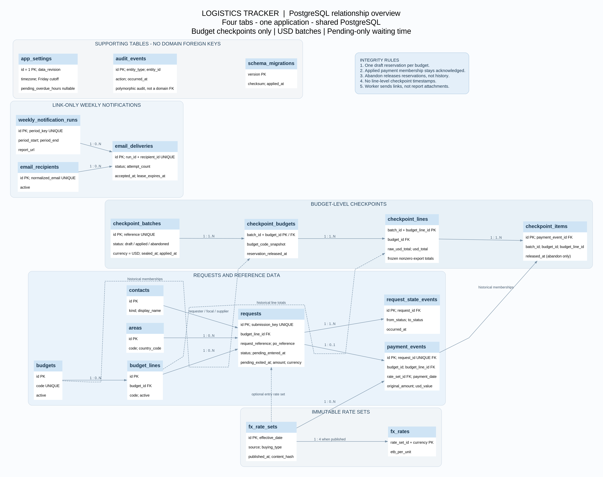

# Logistics Procurement Tracker: PostgreSQL database design

**Version:** 1.0 review candidate  
**Prepared:** 27 October 2026  
**Companion contract:** `PRODUCT_SPECIFICATION.md`  
**Database:** PostgreSQL, one shared application database  
**Deliverable:** logical/physical design and integrity contract, not an executed migration

---

## 1. Design decisions that matter most

1. One request belongs to exactly one budget line; its budget is derived through that line.
2. A request can create at most one immutable payment event.
3. Checkpoints belong to budgets, not lines. There is no line-level checkpoint date.
4. A budget can belong to at most one draft batch at a time.
5. Draft membership and line totals are frozen; new payments stay outside the draft.
6. Applied payment membership remains acknowledged; abandoning a draft releases membership without deleting history.
7. Financial batches use USD. Original request currency/amount and frozen rates remain traceable internally.
8. Friday-to-Friday report membership is a timestamp-bounded query, not a report file generated by the email worker.
9. Recipients and delivery logs live in PostgreSQL. The worker reads recipients from there.
10. Pending entry/exit timestamps support Pending-only waiting-time charts.
11. Exact decimal calculations, constraints and transactions are required; UI checks alone are insufficient [D1-D3].

The design intentionally does not contain users/roles as product entities, budget balances, allocation rows, partial payments, a report-attachment table, or a separate demo/live database switch.

## 2. Diagram files

- `DATABASE_ERD.png`: rendered overview for discussion.
- `DATABASE_ERD.svg`: scalable version of the same relationship overview.
- `DATABASE_ERD.mmd`: editable Mermaid source including the full direct-FK relationship inventory. The rendered overview groups the three contact-role edges and omits redundant payment snapshot arrows for readability.
- `DATABASE_ERD.dot`: exact editable Graphviz relationship source.

The diagram highlights key fields; the dictionaries below define the full schema. The written constraints and transaction rules are authoritative if a visual label is abbreviated. The overview does not display every audit/configuration relationship.

## 3. Conventions

### 3.1 Keys

- Business table primary keys: UUID, generated server-side with `gen_random_uuid()` or an equivalent approved UUID generator [D6].
- Foreign keys use UUID, never human reference strings.
- `app_settings` is a singleton with SMALLINT key 1.
- `schema_migrations.version` is an integer primary key.
- IDs are opaque to R/UI; do not coerce them into 32-bit integers.
- Human references are separate unique fields.

### 3.2 Dates and times

- `TIMESTAMPTZ` for instants: registration, state changes, batch preparation/application, email attempts.
- `DATE` for entered business dates: submission, reference, PO, payment.
- Store instants as PostgreSQL timestamptz; display in Africa/Addis_Ababa by default and label exports. TIMESTAMPTZ represents an instant; the original timezone name is not preserved by that type, so settings/run snapshots retain the business timezone separately [D5].
- Capture one server timestamp per business transition and reuse it for request/state/payment records.
- `registered_at` is immutable server-assigned time, not a user-entered date.
- Calendar filter week: Monday-Sunday.
- Reporting week: Friday cutoff to next Friday cutoff, half-open interval.
- Proposed cutoff: 14:00 EAT, configurable before first scheduled period. See product assumptions A02/A03.

### 3.3 Numeric values

- Original amount: NUMERIC(18,2), positive, finite.
- Quantity: NUMERIC(14,3), optional positive.
- ETB-per-unit rate: NUMERIC(24,10), positive finite.
- Frozen converted payment values: NUMERIC(28,8), nonnegative finite; original amount stays positive even if a tiny converted value rounds at eight decimals.
- Batch line displayed totals: NUMERIC(20,2), positive and nonzero.
- Store positive payment values. The UI/export negates once to show a deduction.
- Perform authoritative valuation/rounding in PostgreSQL decimal arithmetic. PostgreSQL NUMERIC is exact decimal; floating-point types are inexact [D3].
- Reject NaN and infinity explicitly; a positive-value check alone is not a complete finite-value check for PostgreSQL numeric.

### 3.4 Nullability and deletion

Every field is NOT NULL unless explicitly marked nullable below. Optional text uses NULL or empty string consistently through repository mapping; recommended storage is NULL for absence. Required text must also pass a nonblank check.

All historical/business FKs use ON DELETE RESTRICT/NO ACTION. No cascade deletion of requests, payments, batches, recipients with history or rates in use. Ordinary UI never hard-deletes financial/history records.

### 3.5 Snapshots and deliberate duplication

- Request reference-component snapshots preserve issued code/date meaning.
- Payment classification/amount snapshots preserve the Paid event.
- Checkpoint code/line totals preserve exact exported figures.
- Email address/link snapshots preserve what a delivery attempted to send.

These are deliberate historical snapshots, not independently editable competing sources of truth. Triggers/services must enforce their consistency when created.

---

## 4. Entity inventory

Nineteen tables, grouped by purpose:

**Reference data:** budgets, budget_lines, areas, contacts.  
**Requests:** requests, request_state_events.  
**Rates/payments:** fx_rate_sets, fx_rates, payment_events.  
**Finance:** checkpoint_batches, checkpoint_budgets, checkpoint_lines, checkpoint_items.  
**Notifications:** email_recipients, weekly_notification_runs, email_deliveries.  
**Support:** audit_events, app_settings, schema_migrations.

The internal `checkpoint_lines` table is a frozen export grouping, not a line-selection feature and not a line-level checkpoint.

---

## 5. Reference-data tables

### 5.1 budgets

Purpose: budget identity and activity state; no ceiling or balance.

Fields:
- `id UUID`: PK.
- `code VARCHAR(40)`: unique, uppercase normalized business code.
- `name VARCHAR(200)`: required readable name.
- `active BOOLEAN`: default true.
- `created_at TIMESTAMPTZ`, `updated_at TIMESTAMPTZ`.
- `version INTEGER`: positive optimistic version, default 1.

Constraints/indexes:
- Unique(code).
- Nonblank code/name; allowed code characters.
- No code change after use in an issued reference/payment/batch.
- Deactivation service rejects open requests, unapplied paid events or active draft reservation.

**No `last_checkpoint_at` is stored here.** Derive it from applied checkpoint_batches joined through checkpoint_budgets. This avoids two checkpoint clocks disagreeing.

### 5.2 budget_lines

Purpose: a line under one budget.

Fields:
- `id UUID`: PK.
- `budget_id UUID`: FK budgets.
- `code VARCHAR(40)`.
- `description VARCHAR(300)`.
- `active BOOLEAN`: default true.
- `created_at`, `updated_at TIMESTAMPTZ`.
- `version INTEGER`.

Constraints/indexes:
- Unique(budget_id, code).
- Unique(id, budget_id), supporting composite snapshot FKs.
- Parent budget and code immutable once used.
- New requests require both line and parent budget active.
- No line checkpoint timestamp, line checkbox flag, balance or allocation amount.

### 5.3 areas

Fields:
- `id UUID`: PK.
- `code VARCHAR(40)`: unique stable area code.
- `name VARCHAR(200)`.
- `country_code VARCHAR(10)`: e.g. ETH.
- `active BOOLEAN`.
- `created_at`, `updated_at TIMESTAMPTZ`.
- `version INTEGER`.

Code/country reference components cannot silently change after use. Historical request reference snapshots remain unchanged if a descriptive area name is corrected.

### 5.4 contacts

Purpose: requester, focal and supplier lists; not authenticated identities.

Fields:
- `id UUID`: PK.
- `kind VARCHAR(20)`: requester/focal/supplier.
- `display_name VARCHAR(200)`.
- `normalized_name TEXT`: server-maintained lower/trim/whitespace-normalized key.
- `active BOOLEAN`.
- `created_at`, `updated_at TIMESTAMPTZ`.
- `version INTEGER`.

Constraints/indexes:
- Unique(kind, normalized_name).
- Kind cannot change after use.
- Assignment triggers validate that requester_id refers to requester kind, focal_id to focal kind, supplier_id to supplier kind. A simple FK alone does not enforce role.
- Newly assigned contacts must be active. Later deactivation does not erase historical references.

---

## 6. Requests and state history

### 6.1 requests

Purpose: current operational record and issued document references.

Identity/idempotency:
- `id UUID`: PK.
- `submission_key UUID`: unique creation-operation key.
- `submission_payload_hash TEXT`: canonical original creation payload hash, for safe retry comparison.
- `request_reference TEXT`: unique issued OF reference.
- `request_reference_base TEXT`: exact unsuffixed base.
- `request_reference_sequence INTEGER`: positive; 1 for unsuffixed first occurrence.
- `po_reference TEXT`: nullable unique issued PO reference.
- `po_reference_base TEXT`: nullable.
- `po_reference_sequence INTEGER`: nullable positive.

Classification:
- `budget_line_id UUID`: FK budget_lines. No independently editable budget_id.
- `area_id UUID`: FK areas.
- `department_code VARCHAR(20)`: controlled configured list; actual allowed codes supplied by the team.
- `requester_id UUID`: FK contacts.
- `focal_id UUID`: nullable FK contacts.
- `supplier_id UUID`: nullable FK contacts; required from Pending onward and retained if later cancelled.

Content:
- `description TEXT`: required, length-limited.
- `quantity NUMERIC(14,3)`: nullable.
- `unit VARCHAR(80)`: nullable; both quantity/unit or neither.
- `amount NUMERIC(18,2)`: positive finite original request total.
- `currency CHAR(3)`: ETB/USD/EUR/GBP.
- `procurement_scenario VARCHAR(10)`: nullable manual A/B/C/D/E/G.
- `waiver_memo TEXT`: nullable.
- `logistics_remarks TEXT`: nullable.
- `program_remarks TEXT`: nullable.

Business dates:
- `request_date DATE`: submission date.
- `reference_date DATE`: OF reference date.
- `processing_date DATE`: nullable.
- `submitted_to_finance_date DATE`: nullable.
- `po_reason VARCHAR(160)`: nullable; required at approval.
- `po_date DATE`: nullable; required at approval.

State/time:
- `status VARCHAR(20)`: under_review/pending/paid/cancelled.
- `registered_at TIMESTAMPTZ`: immutable server clock timestamp.
- `status_changed_at TIMESTAMPTZ`.
- `pending_entered_at TIMESTAMPTZ`: nullable; set once at approval.
- `pending_exited_at TIMESTAMPTZ`: nullable; set at Paid/cancellation from Pending.
- `cancelled_at TIMESTAMPTZ`: nullable.
- `cancellation_reason TEXT`: nullable except Cancelled.
- `updated_at TIMESTAMPTZ`.
- `version INTEGER`: increment on successful edit/transition.

Historical valuation/reference:
- `entry_rate_set_id UUID`: nullable FK fx_rate_sets.
- `reference_components JSONB`: required structured immutable snapshot: budget_code, line_code, country_code, area_code, department_code, reference_date.
- `po_components JSONB`: nullable immutable snapshot with PO reason/date.

There is **no payment_date column here**. It is obtained from payment_events, preventing two independently editable payment dates.

Constraints/indexes:
- Unique(submission_key), request_reference, po_reference (multiple NULL PO references allowed).
- Unique(request_reference_base, request_reference_sequence).
- Unique(po_reference_base, po_reference_sequence) when populated.
- Unique(id, budget_line_id), supporting payment snapshot FK.
- Index(status, request_date DESC).
- Index(registered_at DESC, id DESC) for arrivals/report/table ordering.
- Index(budget_line_id, status), area_id, requester_id.
- Partial index(pending_entered_at) WHERE status='pending'.
- Optional text-search index only if real query volume justifies it; parameterized ILIKE is sufficient initially.

State-shape checks:
- Under review: no PO/supplier, pending entry/exit absent.
- Pending: supplier/PO/reason/date and pending_entered_at present; pending_exited_at absent.
- Paid: approval information present; pending entry/exit present; exactly one payment event at transaction commit.
- Cancelled before approval: pending entry/exit and PO fields absent.
- Cancelled after approval: pending entry/exit and retained PO fields present.
- Cancelled always has cancellation time/reason.
- Exit cannot precede entry; registered_at cannot be edited/backdated.
- A paid/cancelled old row cannot be updated through ordinary runtime operations.

Reference-defining edit restrictions and other edit rules are assumptions A07/A08 in the product specification. They must be approved before migration/service implementation.

### 6.2 request_state_events

Purpose: immutable transition history and reconciliation of Pending timestamps.

Fields:
- `id UUID`: PK.
- `request_id UUID`: FK requests.
- `event_number INTEGER`: positive, sequential within request.
- `operation_key UUID`: unique idempotency key for this transition.
- `from_status VARCHAR(20)`: nullable only for creation.
- `to_status VARCHAR(20)`.
- `occurred_at TIMESTAMPTZ`.
- `note TEXT`: nullable sanitized explanation.
- `request_version INTEGER`: resulting request version.

Constraints/indexes:
- Unique(request_id, event_number).
- Unique(operation_key).
- Unique(request_id, to_status), valid because this release has no reopening/re-entry.
- Allowed transition pairs only; creation is NULL -> under_review.
- Append-only; no update/delete.
- Deferred consistency trigger verifies request status/pending timestamps agree with the committed event sequence.

State history is retained for audit, but Insights waiting-time metrics use Pending only.

---

## 7. Exchange rates and payment events

### 7.1 fx_rate_sets

Purpose: immutable version of a complete source publication.

Fields:
- `id UUID`: PK.
- `source VARCHAR(40)`: CBE or SYNTHETIC_TEST_FIXTURE.
- `effective_date DATE`.
- `buying_type VARCHAR(30)`: transactionalBuying/cashBuying or synthetic fixture label.
- `fetched_at TIMESTAMPTZ`.
- `content_hash TEXT`: hash of canonical currency/rate/date/subtype content, not raw field ordering.
- `published_at TIMESTAMPTZ`: nullable until validated and complete.
- `source_url TEXT`: nullable nonsecret source reference.

Constraints/indexes:
- Unique(source, effective_date, buying_type, content_hash).
- Consumers may use only published complete sets.
- A published set and its rates cannot be updated/deleted.
- Provider revision creates another set, not overwrite.
- Do not include a future effective date as latest available.

### 7.2 fx_rates

Fields:
- `rate_set_id UUID`: FK fx_rate_sets.
- `currency CHAR(3)`.
- `etb_per_unit NUMERIC(24,10)`.

PK(rate_set_id, currency). Allowed currencies only. Positive finite rates; ETB=1. Publish-set operation verifies exactly the required four currencies. A row-level CHECK cannot enforce four related rows; use publication service plus a deferred/controlled database function.

### 7.3 payment_events

Purpose: immutable financial fact created once when marking Paid.

Fields:
- `id UUID`: PK.
- `request_id UUID`: unique FK requests.
- `budget_id UUID`: immutable snapshot FK budgets.
- `budget_line_id UUID`: immutable snapshot FK budget_lines.
- `original_amount NUMERIC(18,2)`.
- `original_currency CHAR(3)`.
- `payment_date DATE`: user-entered business date.
- `recorded_at TIMESTAMPTZ`: actual Mark Paid instant.
- `rate_set_id UUID`: FK published fx_rate_sets.
- `etb_value NUMERIC(28,8)`.
- `usd_value NUMERIC(28,8)`.
- `eur_value NUMERIC(28,8)`.
- `gbp_value NUMERIC(28,8)`.
- `rounding_policy_version VARCHAR(20)`: e.g. usd_line_v1.

Constraints/indexes:
- Unique(request_id): no partial/multiple payments.
- Unique(id, budget_id, budget_line_id), supporting checkpoint item snapshot FK.
- Composite FK(request_id, budget_line_id) -> requests(id, budget_line_id).
- Composite FK(budget_line_id, budget_id) -> budget_lines(id, budget_id).
- Trigger checks original amount/currency equal the request and computes values from the immutable rate set in NUMERIC.
- Deferred constraint trigger ensures request is Paid at commit, and every Paid request has exactly one event.
- Recorded time equals the Paid state event/pending exit time.
- Append-only; no update/delete through runtime roles.
- Index(budget_id, budget_line_id, recorded_at).
- Index(payment_date, budget_id).

All four converted values are saved for traceable spending charts; Financial Updates uses USD. Rate refresh never changes these values.

---

## 8. Finance checkpoint tables

### 8.1 checkpoint_batches

Purpose: one frozen prepared group, later applied or abandoned.

Fields:
- `id UUID`: PK.
- `creation_key UUID`: unique preparation-operation key.
- `reference VARCHAR(80)`: unique human batch reference, e.g. BATCH-2026-000001 using a database sequence; gaps are allowed.
- `status VARCHAR(20)`: draft/applied/abandoned.
- `currency CHAR(3)`: fixed USD; CHECK currency='USD'.
- `prepared_at TIMESTAMPTZ`.
- `sealed_at TIMESTAMPTZ`: nullable only inside the preparation transaction; every committed batch must be sealed. Sealing freezes budget/line/item membership.
- `applied_at TIMESTAMPTZ`: nullable.
- `abandoned_at TIMESTAMPTZ`: nullable.
- `preparation_note TEXT`: nullable.
- `external_reference_note TEXT`: nullable, captured at application.
- `abandonment_note TEXT`: nullable.
- `preview_fingerprint TEXT`: hash of approved budget/event/valuation set.
- `version INTEGER`.

No independently editable batch total: derive by summing frozen checkpoint_lines. Store a cached total only if a consistency trigger enforces equality; not required in this baseline.

State checks:
- Draft: applied/abandoned times absent.
- Applied: applied_at present, abandoned_at absent.
- Abandoned: abandoned_at present, applied_at absent.
- Terminal rows immutable; no ordinary delete.
- Deferred validator requires sealed_at present, at least one budget, at least one nonzero line per included budget, and at least one event per included line.
- Membership insertion is allowed only while parent batch is unsealed in its preparation transaction. No later append operation is exposed.
- Once set, sealed_at cannot be cleared or changed. Allowed status changes are draft -> applied or draft -> abandoned only; no reopening or unsealing.

### 8.2 checkpoint_budgets

Purpose: included budgets, their draft reservations, and budget-level checkpoint history.

Fields:
- `batch_id UUID`: FK checkpoint_batches.
- `budget_id UUID`: FK budgets.
- `budget_code_snapshot VARCHAR(40)`.
- `budget_name_snapshot VARCHAR(200)`.
- `reserved_at TIMESTAMPTZ`.
- `reservation_released_at TIMESTAMPTZ`: nullable.
- `reservation_release_reason VARCHAR(20)`: nullable; applied/abandoned.

PK(batch_id, budget_id).

**Critical partial unique index:** unique budget_id WHERE reservation_released_at IS NULL.

Meaning:
- Draft: reservation_released_at NULL, budget blocked from another draft.
- Applied: reservation released at applied_at; budget may enter a new batch.
- Abandoned: reservation released at abandoned_at; budget may enter a new batch.

Deferred triggers enforce release fields match parent batch state/time. Historical rows remain permanently.

**Budget checkpoint query:** latest applied_at among applied batches containing that budget. Every line under the budget inherits that context. No checkpoint field is added to budget_lines or checkpoint_lines.

### 8.3 checkpoint_lines

Purpose: frozen nonzero line totals for simple exact export, not line-level selection/checkpointing.

Fields:
- `batch_id UUID`.
- `budget_id UUID`.
- `budget_line_id UUID`.
- `line_code_snapshot VARCHAR(40)`.
- `line_description_snapshot VARCHAR(300)`.
- `raw_usd_total NUMERIC(28,8)`: sum of included payment valuations.
- `usd_total NUMERIC(20,2)`: rounded positive deduction magnitude.
- `rounding_delta NUMERIC(28,8)`: usd_total - raw_usd_total.
- `event_count INTEGER`: positive count of included items.

PK(batch_id, budget_line_id).
Unique(batch_id, budget_id, budget_line_id).
Composite FK(batch_id, budget_id) -> checkpoint_budgets.
Composite FK(budget_line_id, budget_id) -> budget_lines.

Checks:
- raw total positive finite; usd_total positive and nonzero.
- usd_total = ROUND(raw_usd_total, 2).
- rounding_delta equals the exact difference.
- Deferred consistency trigger checks sum/count against checkpoint_items joined to immutable payments.
- No checkpoint timestamp and no editable checkbox field.
- Freeze when parent batch is sealed; do not change on apply/abandon. Membership/sum validation completes in the preparation transaction.

### 8.4 checkpoint_items

Purpose: exact event membership, including released historical memberships.

Fields:
- `id UUID`: PK.
- `batch_id UUID`.
- `budget_id UUID`.
- `budget_line_id UUID`.
- `payment_event_id UUID`.
- `included_at TIMESTAMPTZ`.
- `released_at TIMESTAMPTZ`: nullable, populated only when draft is abandoned.

Constraints:
- Unique(batch_id, payment_event_id).
- Composite FK(batch_id, budget_id, budget_line_id) -> checkpoint_lines.
- Composite FK(payment_event_id, budget_id, budget_line_id) -> payment_events.
- **Critical partial unique index:** unique payment_event_id WHERE released_at IS NULL.

Meaning differs deliberately from budget reservation:
- Draft item: released_at NULL, event reserved.
- Applied item: released_at remains NULL forever, event acknowledged and cannot re-enter another batch.
- Abandoned item: released_at set; event available for a later batch, while old membership remains visible.

Insertion requires an unsealed parent batch. After sealing, only the controlled abandonment release is permitted; no membership ID/value changes.

Do not release applied items when releasing the budget reservation. That would permit double deduction. Do not delete abandoned items to make a unique constraint pass.

---

## 9. Notification tables

### 9.1 email_recipients

Fields:
- `id UUID`: PK.
- `display_name VARCHAR(200)`: nullable.
- `email VARCHAR(320)`: display/original address.
- `normalized_email VARCHAR(320)`: lower/trim key under the agreed case-insensitive recipient policy.
- `active BOOLEAN`: default true.
- `created_at`, `updated_at TIMESTAMPTZ`.
- `deactivated_at TIMESTAMPTZ`: nullable.
- `version INTEGER`.

Unique(normalized_email). Remove means deactivate; reactivation reuses the same row. Changing address creates/reactivates another address identity, preserving old history. This is a recipient list, not a sender-credential store.

### 9.2 weekly_notification_runs

Purpose: one notification campaign per completed Friday reporting period; not a stored report file.

Fields:
- `id UUID`: PK.
- `period_key DATE`: local Friday ending date, unique.
- `period_start TIMESTAMPTZ`.
- `period_end TIMESTAMPTZ`.
- `business_timezone VARCHAR(80)`.
- `cutoff_local TIME`.
- `settings_version INTEGER`.
- `report_url TEXT`: trusted configured application deep link snapshot.
- `created_at TIMESTAMPTZ`.
- `last_checked_at TIMESTAMPTZ`.

Checks:
- period_end > period_start.
- period_key is Friday in the configured local schedule.
- Seven local calendar days between boundaries; construct in timezone rather than blindly assuming every timezone week is always 168 hours.
- period_end must already have occurred before sending.
- Unique(period_key) prevents duplicate campaigns if scheduler repeats.
- No report attachment/blob, generated spreadsheet or request-membership rows here.

The report itself is queryable even if no run row exists yet. App and worker use the same period calculation. Cutoff/timezone changes after campaigns exist require a controlled settings change; do not reinterpret old run boundaries.

### 9.3 email_deliveries

Purpose: recipient-level queue, attempt and outcome ledger.

Fields:
- `id UUID`: PK.
- `run_id UUID`: FK weekly_notification_runs.
- `recipient_id UUID`: FK email_recipients.
- `recipient_email_snapshot VARCHAR(320)`.
- `status VARCHAR(20)`: queued/sending/sent/failed/uncertain/suppressed.
- `attempt_count INTEGER`: default 0, nonnegative.
- `next_attempt_at TIMESTAMPTZ`: nullable.
- `last_attempt_at TIMESTAMPTZ`: nullable.
- `lease_token UUID`: nullable.
- `lease_expires_at TIMESTAMPTZ`: nullable.
- `accepted_at TIMESTAMPTZ`: nullable, provider accepted send.
- `provider VARCHAR(80)`: nullable until configured.
- `provider_message_id TEXT`: nullable.
- `message_id TEXT`: stable generated email Message-ID; not an exactly-once guarantee.
- `last_error_code VARCHAR(80)`: nullable sanitized.
- `last_error_message TEXT`: nullable sanitized.
- `attempt_log JSONB`: append-only sanitized attempt summaries; automated retries are bounded, no secrets.
- `created_at`, `updated_at TIMESTAMPTZ`.

Constraints/indexes:
- Unique(run_id, recipient_id).
- Index(status, next_attempt_at) for queue.
- Sending requires a lease token/expiry; terminal sent requires accepted_at.
- Queued/sending rows recheck active recipient before provider call.
- Expired sending lease with ambiguous outcome -> uncertain; do not blindly resend.
- Provider accepted is not delivered/read. Do not name accepted_at delivered_at.
- Address snapshot immutable once attempted; changing a recipient does not rewrite old logs.

The worker role may select active recipients/settings/schema version and insert/update runs/deliveries only. It has no write access to requests/payments/checkpoints.

---

## 10. Support tables

### 10.1 audit_events

Fields:
- `id UUID`: PK.
- `entity_type VARCHAR(40)`.
- `entity_id UUID`: nullable for singleton/config/system events.
- `action VARCHAR(80)`.
- `occurred_at TIMESTAMPTZ`.
- `operation_key UUID`: nullable.
- `before_values JSONB`: nullable, limited changed fields.
- `after_values JSONB`: nullable, limited changed fields.
- `details JSONB`: nullable.
- `actor_label VARCHAR(200)`: nullable, explicitly unverified without authentication.

Append-only. Index(entity_type, entity_id, occurred_at DESC).

This polymorphic audit reference is intentionally not a physical FK to every possible entity. Business integrity is enforced by the actual domain FKs, not by the audit table. Do not store passwords, SMTP tokens or full unredacted provider payloads.

### 10.2 app_settings

Singleton fields:
- `id SMALLINT`: PK, CHECK id=1.
- `business_timezone VARCHAR(80)`: default Africa/Addis_Ababa.
- `weekly_cutoff_local TIME`: proposed 14:00.
- `request_default_currency CHAR(3)`: ETB.
- `finance_currency CHAR(3)`: USD, fixed check.
- `cbe_buying_type VARCHAR(30)`: proposed transactionalBuying.
- `fx_max_age_days INTEGER`: proposed 7, nonnegative bounded.
- `pending_overdue_hours INTEGER`: nullable positive; NULL disables overdue classification.
- `notification_catchup_hours INTEGER`: proposed 72.
- `application_base_url TEXT`: trusted HTTPS origin/path.
- `settings_version INTEGER`.
- `data_revision BIGINT`: monotonic shared-refresh counter.
- `updated_at TIMESTAMPTZ`.

No database password, sender password, API key or deployment token. Sender address/provider/authentication are worker environment/secret configuration.

Increment data_revision at the end of successful business transactions. Do not use it as a row version for unrelated records. Worker can read it but need not update it for every delivery attempt; delivery status can use its own polling if exposed.

### 10.3 schema_migrations

Fields:
- `version INTEGER`: PK.
- `description TEXT`.
- `checksum TEXT`.
- `applied_at TIMESTAMPTZ`.

Only migration role writes. App checks expected schema version; does not silently create/drop schema per session. Already-applied migrations are immutable; add a new migration for changes.

---

## 11. Exact relationship inventory

- budgets 1 -> 0..many budget_lines.
- budget_lines 1 -> 0..many requests.
- areas 1 -> 0..many requests.
- contacts 1 -> 0..many requests through requester/focal/supplier FKs.
- requests 1 -> 1..many request_state_events.
- requests 1 -> 0..1 payment_events.
- fx_rate_sets 1 -> 4 fx_rates once published.
- fx_rate_sets 1 -> 0..many requests as optional entry snapshot.
- fx_rate_sets 1 -> 0..many payment_events.
- checkpoint_batches 1 -> 1..many checkpoint_budgets.
- budgets 1 -> 0..many payment_events as immutable classification snapshots.
- budget_lines 1 -> 0..many payment_events as immutable classification snapshots.
- budgets 1 -> 0..many historical checkpoint_budgets, at most one unreleased draft reservation.
- checkpoint_budgets 1 -> 1..many checkpoint_lines for that batch/budget.
- budget_lines 1 -> 0..many historical checkpoint_lines.
- checkpoint_lines 1 -> 1..many checkpoint_items.
- payment_events 1 -> 0..many historical checkpoint_items, at most one unreleased membership.
- weekly_notification_runs 1 -> 0..many email_deliveries.
- email_recipients 1 -> 0..many email_deliveries.

There is no direct relationship between email recipients and requesters unless a future approved feature adds it. Being a requester does not automatically subscribe a person.

---

## 12. Enforcement matrix

### 12.1 Ordinary constraints

Use PK/FK/UNIQUE/CHECK for:
- Existence and parent-line consistency.
- One payment per request.
- Unique references/submission keys.
- Allowed states/currencies/kinds.
- Positive finite amounts/rates and date-shape invariants.
- One draft reservation per budget.
- One current payment membership.

PostgreSQL supports these constraints; partial unique indexes enforce uniqueness over selected rows [D1, D4].

### 12.2 Triggers/controlled transactional functions

Cross-row rules cannot be implemented as a CHECK containing a query. PostgreSQL warns against CHECK constraints depending on other rows/tables [D1]. Use deferred constraint triggers and controlled write functions for:
- Paid request <-> exactly one payment event at commit.
- State event/request timestamp consistency.
- Complete published rate set.
- Checkpoint line sum/count matching exact items.
- Reservation release fields matching batch state.
- Item release only on abandonment; applied item never released.
- Contact role validation.
- Payment amount/classification equality to request at creation.
- Reference-defining fields and immutable historical rows.
- Committed batches sealed with minimum membership cardinalities; no post-seal membership inserts.
- Active master-data assignment/deactivation checks serialized against the parent budget/assigned master row.

At least one of database-enforced controlled write functions or carefully tested triggers must protect each invariant. Do not write 'the UI prevents it' as the only enforcement.

### 12.3 Runtime permissions

- Migration role: schema creation/alteration and version writes.
- App role: necessary SELECT and approved business operations; no DROP/TRUNCATE, no ordinary history deletes. Runtime DML must be protected by the triggers described above, or restricted to allowlisted transactional functions with no raw-table DML grants. Choose and test one write mechanism during implementation; do not leave a bypass path.
- Worker role: recipients/settings/schema SELECT and notification ledger operations only.
- Test role/schema: isolated and never pointed at the shared acceptance database by default.

A SECURITY DEFINER function, if used, must set a safe search_path and have tightly scoped EXECUTE grants. Do not expose a broad privileged function to the browser or an unrestricted public endpoint.

---

## 13. Transaction and lock order

Use READ COMMITTED plus explicit row/advisory locks and constraints for the baseline; do not assume a transaction alone prevents write races. PostgreSQL documents row/advisory locking and deadlock considerations [D2].

### 13.1 Common lock order

For operations that need these categories, acquire in this order:
1. Existing checkpoint batch row, if any.
2. Existing request rows, ascending UUID order, if any.
3. Budget rows, ascending UUID order.
4. Child reservation/item rows, in deterministic order.
5. app_settings revision row last.

No batch operation locks request rows. Mark Paid locks request then budget. Prepare locks budgets then reads immutable payment events, not requests. Apply/abandon locks batch then budgets. This avoids a budget->request / request->budget cycle.

Creation also locks the parent budget before checking active line status, so concurrent budget/line deactivation cannot race a new request. Master-data deactivation must use the same parent-budget-before-line order and must not lock existing request rows after locking a budget.

Deferred validators read the already protected data and must not introduce reverse-order row locks.

Reference advisory locks are acquired only within request creation/approval and before issuing the corresponding reference; no finance operation acquires them. Do not add a reverse lock path later without review.

### 13.2 Mark Paid versus batch preparation

Both serialize on the budget row:
- If Paid commits before Prepare locks the budget, it can be in the preview/confirmed candidate set.
- If Prepare commits first, the later payment remains outside that draft.
- If the preview changed, confirmation is refreshed; no silent membership expansion.

### 13.3 Prepare algorithm

1. Validate selected budget IDs and confirmation token.
2. Begin transaction; lock selected budgets in sorted order.
3. Reject inactive/reserved budgets or changed preview.
4. Select payment events with no unreleased checkpoint item.
5. Group by budget/line; compute raw USD sums and rounded line totals.
6. Exclude rounded-zero lines, retaining their unacknowledged events.
7. Reject any selected budget with no eligible nonzero line.
8. Insert unsealed batch, budget reservations, frozen lines, exact items; then set sealed_at. No unsealed batch may commit.
9. Deferred checks verify sums/membership/state.
10. Audit/revision; commit.

Any conflict rolls back the entire selected set. A unique-constraint violation becomes a budget_reserved/conflict message, not a disconnected Shiny session.

### 13.4 Apply algorithm

1. Begin; lock batch and included budgets.
2. Recheck draft/version/confirmation.
3. Set applied_at/status/note.
4. Release checkpoint_budgets reservations with reason applied.
5. Keep checkpoint_items.released_at NULL.
6. Preserve line totals and membership.
7. Audit/revision; commit.

### 13.5 Abandon algorithm

Same lock/recheck pattern, then:
- Set abandoned state/time.
- Release budget reservations with reason abandoned.
- Set item released_at to abandonment time.
- Keep historical items/line totals.
- Audit/revision; commit.

### 13.6 Reference collision algorithm

- Build canonical base from approved snapshots.
- Acquire transaction advisory lock on kind+base.
- Read highest sequence for that base; allocate next.
- First uses exact base; later use /002, /003 etc.
- Formatting must not truncate sequence values above 999.
- Insert with unique constraints; commit with request transition.
- Cancelled references remain in the allocation set and are never reused.

This is assumption A08, not an organizational numbering rule supplied by the sample.

---

## 14. Query contracts and reconciliation

### 14.1 Current payment membership

For each payment event, consider only checkpoint_items with released_at NULL. There is at most one by constraint. Join its batch:
- no current item -> available.
- draft -> reserved.
- applied -> acknowledged.

Do not join all historical abandoned items into a sum. That duplicates amounts.

### 14.2 Budget financial view

- Start from all active budgets, left join lines and totals, coalesce absent values to zero.
- Reserved line value comes from frozen checkpoint_lines in the budget's one current draft.
- Available line value = ROUND(SUM(unreserved payment_events.usd_value),2).
- Unapplied line = reserved + available.
- Budget values sum line values, so expansion reconciles.
- Only budgets needing update means at least one nonzero unapplied line.
- Selection eligibility additionally requires no active draft and at least one nonzero available line.

Raw reconciliation: all payment raw USD = acknowledged raw USD + reserved raw USD + available raw USD. Exported applied totals include saved line rounding deltas, so they need not equal rounding all historical spending once. This is a documented rounding basis, not permission to change old values.

A tiny available raw value rounding to zero is not silently discarded. It remains in the database and can be shown in diagnostics, but does not create a zero export row.

### 14.3 Last checkpoint

For a budget, MAX(applied_at) over applied batches with its checkpoint_budgets membership. Never derive from payment_date, request_date or draft preparation. Never display separate line checkpoint dates.

### 14.4 Batch export

Read frozen checkpoint_lines joined to checkpoint_budgets snapshots for one batch. Export only code/code/negative usd_total plus header metadata. Do not recalculate using today's rates or all currently unpaid rows.

### 14.5 Weekly report

`registered_at >= period_start AND registered_at < period_end`, all states, current descriptive/state fields. App query works without notification-run existence. Deep-link period is validated and computed in business timezone.

### 14.6 Pending metrics

- Current Pending: now - pending_entered_at.
- Completed: pending_exited_at - pending_entered_at.
- No Under-review duration included.
- Threshold NULL -> age statistics only, no overdue label.
- Cohort filters use pending_entered_at unless another clearly labelled chart variant is approved.

---

## 15. Migrations, seeds and deployment

- Target PostgreSQL only for this baseline; do not build SQLite fallback/mode routing.
- No migration script is executed as part of this design delivery. The exact PostgreSQL major version will be pinned with the hosting configuration; do not assume a preview/release-candidate server version is required.
- First migration creates tables, indexes, constraints, functions/triggers, settings and roles/grants as approved.
- Existing local prototype data is not automatically imported. A later explicit import maps references/dates and reconciles totals if required.
- Seed uses stable UUIDs/fixture keys and unique operation keys, inserts through the same business rules, and can be rerun without duplicates.
- Do not disable integrity triggers to make fixtures pass. Boundary tests use an injected clock in an isolated test database, not a browser-controlled production clock or editable registration timestamp. Shared sample records use their actual seed registration time; a previous completed weekly period may legitimately contain zero records.
- App startup checks connection/schema and returns a clear configuration message if unavailable.
- App and worker share the configured PostgreSQL database; no hard-coded recipient file.
- Back up PostgreSQL and test restoration to an isolated database before release acceptance.
- Keep secrets outside SQL files and source control.

Detailed physical folder structure and UI generation are intentionally next-phase deliverables, not mixed into this design review.

---

## 16. Review points and non-claims

The user confirmed PostgreSQL, budget-only selection, shared budget checkpoints, USD batches, frozen drafts, reserved/new split, simple export and Pending-only waiting time.

Review the companion specification's explicit assumptions before coding, especially:
- Friday cutoff time and registration-time report membership.
- Intermediate editing restrictions and reference collision suffix.
- CBE buying subtype, stale-rate policy and valuation date.
- Precision/line rounding for tiny USD amounts.
- Optional fields and exact validation limits.

This design has been cross-checked for entity names, relationships, lifecycle and budget/item reservation semantics. It is not a claim that PostgreSQL migrations, concurrency tests, email sending or the deployed app have already been executed successfully.

---

## 17. Technical references

[D1] Constraints and cross-row CHECK limitations: https://www.postgresql.org/docs/current/ddl-constraints.html

[D2] Row/advisory locks and deadlocks: https://www.postgresql.org/docs/current/explicit-locking.html

[D3] NUMERIC precision/rounding: https://www.postgresql.org/docs/current/datatype-numeric.html

[D4] Partial indexes and uniqueness: https://www.postgresql.org/docs/current/indexes-partial.html

[D5] Date/time types and timezone semantics: https://www.postgresql.org/docs/current/datatype-datetime.html

[D6] UUID generation: https://www.postgresql.org/docs/current/functions-uuid.html
