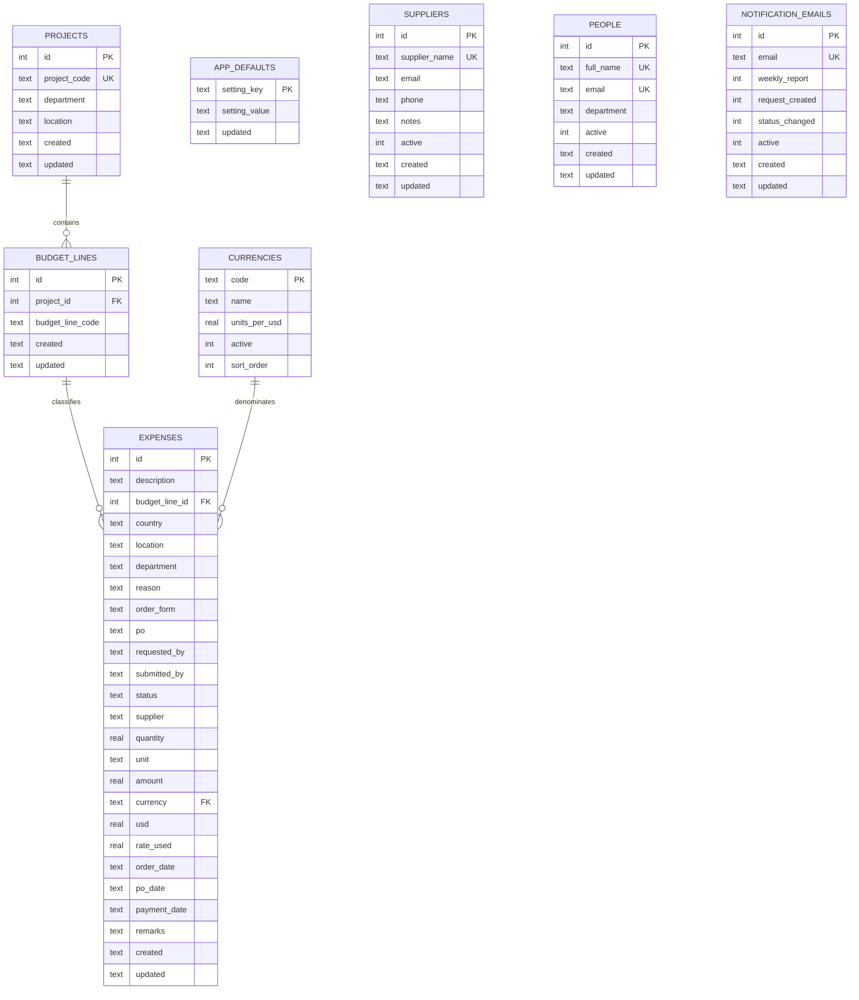

# ACTED Expense Tracker — Requirements and Implementation Plan

**Document purpose:** Consolidated product requirements, user experience plan, business rules, data model, implementation priorities, and acceptance criteria for the Expense Tracker built with R Shiny.

**Status:** Working requirements baseline based on the conversation, supplied wireframes, existing Shiny source, and current schema file. It is not a substitute for testing the application against the live `tracker.db` database.

---

## 1. Product goal

Replace the current Excel-based logistics/procurement tracking process with a simple, intuitive web app that:

1. Makes request entry and updating smooth for logistics staff.
2. Lets staff find and review requests quickly.
3. Gives management clear information about requested and paid amounts over monthly, quarterly, and yearly periods.
4. Keeps project codes, budget lines, suppliers, people, currency settings, and request defaults in one shared SQLite database.
5. Reduces duplicated entry and improves consistency through database-backed catalogues and generated references.

The primary management output is **how much has been spent during a chosen time period**, with useful breakdowns by status, department, project, requester, and budget line.

Replace the Excel sheet used for logistics procurement tracking (scenarios A–G) with a shared web app. It should make data entry minimal and give management a monthly view of spending.

### Explicit scope boundaries

- Runtime: **R Shiny**, not Python.
- Database: SQLite, with `tracker.db` **as the single application database**.
- Multiple staff use a common database. Authentication and role-based authorization are not required at this stage.
- we don't have budget data
- A separate information/help page is not required at this stage.
- Custom date-range filtering is required on the Requests page, but not on the  Dashboards page for now.
- Email recipient preferences can be stored now; actual email delivery needs a mail provider/SMTP configuration and a scheduler.
- Views are shared by a short link that carries only the current filters.

## 2. User groups and primary workflows

### 2.1 Logistics focal point

- Create a new procurement request.
- Select a configured project and one of its budget lines.
- Add amount, currency, requester, supplier, location, and department.
- Review the automatically generated Order Form reference.
- Open an existing request and update status or procurement details.
- Generate/persist the Purchase Order reference when the request moves into Under validation.

### 2.2 Requester / staff member

- Have requests associated with the correct `Requested by` person.
- Find requests using filters, search, and status cards.
- Review request details and current status.

### 2.3 Management

- Review spending and request volumes for a month, quarter, or year.
- Switch report types and display currencies.
- Compare status, department, and project patterns.
- Use breakdown tables/charts to investigate a selected status and grouping.

### 2.4 Person maintaining app catalogues

- Add project codes and map budget lines to the correct project.
- Maintain suppliers and contact information.
- Maintain staff/contact suggestions and email notification recipients.
- Configure request defaults.

There are no separate roles or permissions in the current scope; these are user journeys, not authorization levels.

---

## 3. Application information architecture

The top-level navigation is intended to contain three work areas:

1. **Requests** — request register and request workflow.
2. **Financial Update** - **Purpose:** show current (not yet deducted) spending grouped by project, so each request line can be batched together and finance can deduct the current period's expenses from the actual budget.
3. **Dashboards** —  quick insights, charts, separated from the request register.
4. **Manage** — project/budget-line catalogue, suppliers, email subscriptions, people, and request defaults.

The **New request** form opens as a dedicated full page, rather than a small modal. It has a Back to requests action, Clear form, Cancel, and Add request actions. The Manage gear icon should take users to the management area. Light/dark mode is available globally.

A footer can remain minimal, showing the application name and purpose.

### 3.1 Requests page layout

- Persistent, always-visible **left filter sidebar**.
- Main content to the right: page heading, New request action, status-count cards, then the request register.
- Register toolbar: status filter beside the global search field; Export and Share view controls in the table header.
- The register must remain usable at normal and very wide viewport sizes without clipped content or unnecessarily stretched forms.

### 3.2 Financial Update Layout

1. **Layout:**
   - A table of spending grouped by project, with the request lines listed under each project.
   - A **project dropdown** (budget list) to select all projects or specific ones.
   - A **Batch** button to group the selected request lines into one batch.
   - An **Export** button, available after batching, to export the batch.
   - A **Confirm update** button to confirm that the batch was actually deducted from the real budget.

   **Rules:**
   - The app has no budget data and does not perform the deduction. The person in charge deducts from the actual budget outside the app, then uses Confirm update to record that it was done.
   - After Confirm update, each confirmed project's current-period total **resets to zero**.
   - Each project shows a **Last seen** field with the date and time the confirmation was applieds.

###  Dashboards layout

- quick information cards
- filters
- charts with dropdown to choose type

### 3.3 Manage layout [keep this in the right end of nav bar as a settings besides theme]

Use compact tabs/cards, avoiding a large, complicated settings form. Expected subsections:

- **Project & Supplier:** project and budget-line creation/listing on one side; supplier entry/register on the other.
- **Emails:** email recipients and subscription options, with request defaults in a companion panel.
- **People & other:** staff/contact list with name, email, and department.

The supplied hand-drawn references are layout guidance, not strict pixel-level specifications. Preserve their structure while improving spacing, readability, responsiveness, and form hierarchy.


---

## 4. Requests page requirements

### 4.1 Sidebar filters

The current filter set is:

1. Month
2. Week
3. Project code(s)
4. Budget line(s)
5. Requested by
6. Submitted by
7. Date range (at the end)

Rules:

- On initial app opening, Month defaults to the **current month**.
- Month and Week filters work together.
- If either endpoint of the date range is set, the date range takes precedence over Month and Week.
- The Budget line control remains visible even before a project is selected. Without a project selection it should explain that project code(s) must be selected first; with project codes selected, it loads only budget lines belonging to those projects.
- Project codes and budget lines are sourced from the database catalogue, not from expense rows. Newly configured entries must appear immediately, even before an expense uses them.
- **Clear filters** clears every Requests filter, including Month (sets it to All months/empty), Week, Project, Budget line, Requested by, Submitted by, Date range, and the Request breakdown's project selection where applicable. It must not immediately reapply the current-month default.
- A shared link restores the filter state encoded in that link. If it carries no month/date constraint, the app should not silently reapply the initial current-month filter.

### 4.2 Status cards and register interaction

### 4.7 Status Workflow

Statuses: **Under review, Pending, Paid, Rejected.**

Allowed transitions:

- Under review → Rejected
- Under review → Pending → Paid

Rules:

- A new request starts as Under review.
- The **PO is generated** at the moment a request moves from Under review to Pending.
- Rejected and Paid are final. *(confirm)*
- Pending → Rejected and skipping Pending (Under review → Paid) are not allowed.

Show count cards for:

- Under Review
- Pending
- Paid
- Rejected

Clicking a card filters the register to that status while respecting the current sidebar filters. The table status filter and cards should stay synchronized. A selected card should have a visible active state.

### 4.3 Request register

Display these key columns:

- Description (truncate long text in the row; offer a way to see the full text)
- Project code
- Budget line
- Quanity
- Unit
- Requested by
- Amount (currency code shown)

Do not repeat Status as a normal data column; status belongs in the status filter and in the detailed request view. The Open action must open the correct record. Search should search the visible record fields and be positioned adjacent to the status filter. Table paging, empty states, sorting, and export should remain clear in light and dark themes.

### 4.4 New request form

The form should be full-page, minimally cluttered, and responsive. Explain required fields once; mark required fields clearly without repeating verbose Required/Optional tags on every field. Keep optional fields visible, not collapsed in a hidden details section.

**Required fields in the current implementation:**

- Description
- Requested by
- Project code
- Budget line
- Department
- Location
- Supplier
- Amount
- Currency

**Optional fields:**

- Country
- Quantity
- Unit
- Framework agreement flag
- Submitted by (logistics focal point; normally prefilled)
- Order date (normally defaults to today)
- Remarks

Country is optional. Place Quantity, Unit, and Framework agreement near the top of the optional-details section. Requested by and Submitted by are different concepts and must remain separate fields.

Defaults read from SQLite should prefill Submitted by, Country, and Currency. Current seed examples are `Betty T`, `ETH`, and `ETB`; the configured values can be changed in Manage. Department is limited to REACH, PANDA, ACTED. Project and budget-line inputs must enforce the configured project-to-budget-line mapping.

The supplier picker should use the supplier catalogue while preserving existing free-text supplier values in historical records.

### 4.5 Open request details/editing

The Open button opens the selected request in detail/edit mode. Show at minimum the request's saved fields and status. Provide a dedicated **Generated references** area showing both Order Form (OF) and Purchase Order (PO) values. The values should be read from SQLite; if legacy references are missing, a valid preview can be shown when all required source fields are available.

Status changes, procurement dates/reason, and all changes to an existing request must be persisted to `tracker.db` and reflected in the register/dashboard.

---

## 5. Dashboards requirements

### 5.1 Purpose and reporting filters

The dashboard focuses on request value, paid spending, status composition, and patterns across projects/departments. It must not show budget allocation or budget-vs-spend indicators.

Dashboard filters:

- Period type: Month, Quarter, or Year.
- Year selector.
- Month selector when Period = Month.
- Quarter selector when Period = Quarter.
- Display currency: ETB, USD, EUR, GBP (or the active currency catalogue entries).
- Project code(s).
- Department(s).

There is **no custom date-range filter on the dashboard for this iteration**. Dashboard filters are independent from Requests filters.

### 5.2 KPI cards

At minimum show:

- Total request value for the selected dashboard scope.
- Paid spend.
- Waiting value and request count.
- Under validation value and request count.
- Rejected value and request count.

Use labels that distinguish requested/committed value from paid spend. Avoid duplicate panels (for example, a separate “At a glance” panel duplicating status cards).

### 5.3 Main report selector

The primary chart supports:

- Spending by status
- Requests by status
- Spending by department
- Spending by project

The chosen report must use the dashboard's period, currency, project, and department filters. Use a suitable chart for each output: status comparisons should be easy to compare; department spending should be a pie/donut chart when the main report is by department; project spending should use a sorted horizontal bar chart when labels are long.

### 5.4 Trend and Request breakdown

- Include a trend chart for spend/request values over the selected dashboard period, with statuses consistently colored.
- Include a Request breakdown with Status and Group by controls, and Chart/Table views.
- Group by options include Project, Requester, and Department. A Budget line view is only available when project context has been selected through the project-specific breakdown selector, where applicable.
- For Project grouping with no specific breakdown project selected, show only non-zero project totals in descending order.
- When a project is selected, show only that project's budget lines with non-zero value for the selected status/currency and current dashboard scope. Do not mix all project totals and all budget-line rows into one overview chart; do not repeat the project total in the budget-line drill-down.
- The Clear control for the breakdown project selection clears it and should not preserve an inherited/default project filter unexpectedly.
- Chart and Table views must reflect the same scope and ordering.

### 5.5 Currency handling

The current source represents conversion rates as units of each currency per 1 USD. Expense records retain `usd` and `rate_used` so historical reports can use the entry-time conversion rather than silently changing old values when a rate is edited. The current default seed values in code are ETB=155, USD=1, EUR=0.92, GBP=0.79; these are configuration placeholders and must be checked/maintained by the project owner before operational use.

### 5.6 Status and department colors

Use consistent status colors across KPI indicators, status charts, notifications, and status-related breakdown charts:

| Status       | Color | Hex       |
| ------------ | ----- | --------- |
| under review | Gray  | `#94a3b8` |
| Pending      | Amber | `#f59e0b` |
| Paid         | Green | `#16a34a` |
| Rejected     | Red   | `#dc2626` |

The department pie chart is a special case and uses fixed department colors:

| Department | Color | Hex |
|---|---|---|
| REACH | Red | `#e94f52` |
| PANDA | Green | `#006b45` |
| ACTED | Blue (retain) | `#0284c7` |

Notification types should also be intuitive: success green, warning amber, error red, and neutral/information gray. Primary-button text must remain white and readable in dark mode.

---

## 6. Manage requirements

### 6.1 Project codes and budget lines

- Add a project code, with optional department and default location.
- Add a budget line to an existing project.
- Prevent case-insensitive duplicate project codes.
- Prevent duplicate budget-line code within the same project; the same budget-line code may be used under different projects.
- Do not hard-enforce alphanumeric-only codes. Use `EDUAMH2026` and `TRAVEL01` as examples only; existing formats and descriptive values remain allowed.
- Catalogue additions must persist in SQLite and immediately refresh form choices and filters.
- Project identity for an expense is derived through `expenses.budget_line_id -> budget_lines.project_id -> projects.id`, rather than storing a separate, potentially conflicting project foreign key.

### 6.2 Supplier catalogue

- Add and maintain supplier name, email, phone, notes, and active/inactive state.
- Supplier names should be unique case-insensitively.
- New/active suppliers should be selectable on the request form.
- Existing expenses retain a text snapshot of supplier name so historical records remain readable if a catalogue record is later changed.

### 6.3 People

- Maintain full name, email, department, and active state.
- Name and email uniqueness should be handled case-insensitively where populated.
- People data improves suggestions for Requested by and Submitted by but must not break historical text values.

### 6.4 Email notification recipients

Store recipient email and preferences for:

- Weekly request summary
- New request submitted
- Request status changed
- Active/inactive recipient

These preferences are database configuration only until actual email sending is wired up. Delivery requires a reliable email provider/SMTP configuration, handling for failures, and a scheduler/worker for weekly reports.

### 6.5 Request defaults

Persist the default logistics focal point (`submitted_by`), country, and currency in the database. Changing defaults should affect new requests only and must not rewrite existing records. Default currency must be from the active currency catalogue.

---

## 7. Business rules: scenario, OF, and PO

### 7.1 Procurement scenario mapping

Scenario is mapped from request amount converted to USD, unless Framework agreement is selected:

| Scenario | USD-equivalent threshold | Label |
|---|---:|---|
| A | `< 500` | Direct purchase |
| B | `500 to < 5,000` | Quotations |
| C | `5,000 to < 30,000` | Contract |
| D | `30,000 to < 150,000` | National/Local call for tender |
| E | `>= 150,000` | International call for tender |
| G | Framework agreement selected | Framework agreement |

The configured expected lead times in the current source are indicative and should be verified against ACTED policy before being treated as formal service targets.

### 7.2 Order Form (OF)

OF is generated from the project code, budget line, optional country, location, department, and order date. Intended pattern:

`OF/{project}/{budget line}/{country if present}/{location}/{department}/{DD-MM-YYYY}`

Country is optional and omitted from the reference when empty. OF should be visible in request details and included in exports.

### 7.3 Purchase Order (PO)

PO is generated when a request moves to **Under validation** (and also handled for Paid when appropriate) using project, budget line, optional country, location, department, PO reason, and PO date. Intended pattern:

`PO/OF/{project}/{budget line}/{country if present}/{location}/{department}/{reason}/{DD-MM-YYYY}`

- For transition to Under validation, PO reason and PO date are required.
- Save the generated PO reference to the expense row.
- Show both OF and PO in Open request details.
- Export both references.
- Do not silently erase an existing PO reference when a record moves to another status; preserve historical generated reference unless an explicit policy says otherwise.

The application should validate the required inputs before attempting reference generation and give actionable feedback if it cannot generate a reference.

---

## 8. Database design

Use one SQLite database, `tracker.db`. The latest source and provided SQL schema describe these tables:

| Table | Purpose |
|---|---|
| `projects` | Project-code catalogue with optional department/location metadata |
| `budget_lines` | Budget-line catalogue; each row belongs to one project |
| `expenses` | Procurement request and financial record |
| `currencies` | Active currency codes, names, conversion rates, sorting/active flags |
| `app_defaults` | Key/value application defaults |
| `suppliers` | Supplier/contact catalogue |
| `people` | Staff/contact catalogue |
| `notification_emails` | Email recipients and notification subscriptions |

### 8.1 ERD



### 8.2 Integrity and history

- Enable SQLite foreign keys on every database connection.
- `projects.project_code` is unique case-insensitively.
- `budget_lines` has a unique constraint on `(project_id, budget_line_code)`.
- `expenses.budget_line_id` references `budget_lines.id`; deleting a budget line referenced by an expense is restricted.
- `expenses.currency` references `currencies.code`.
- The supplier name on an expense is a text snapshot for historical accuracy, not a foreign key in the current source.
- Amount, currency, USD equivalent, and entry-time rate should remain historically interpretable.
- The app should print the fully resolved database path on startup. Default path is `tracker.db` beside the app; `TRACKER_DB_PATH` can override it explicitly.
- Do not use or silently fall back to `tracker_demo.db`. A demo database should only be used if explicitly requested and supplied separately.
- Before migrating a legacy database, create and verify a SQLite-consistent backup. If a backup cannot be made, cancel migration rather than risk operational data.

---

## 9. Design system and usability

### Visual direction

- Minimal, functional, operations-focused UI.
- shadcn-inspired component hierarchy and restrained styling.
- Zinc neutral surfaces, Sky/blue primary actions, Inter-style typography, Lucide-style icons, clear borders, and consistent corner radius.
- Light and dark themes, with readable text, visible control boundaries, and white primary-button text in dark mode.
- Status colors as defined in section 5.6; department chart colors remain department-specific.
- Use responsive grids that look intentional on laptop, desktop, and very wide screens.
- Keep optional form fields visible. Avoid hiding useful controls under unnecessary “More details” disclosures.
- Labels should be concise, field spacing consistent, and errors should be actionable.
- Empty states should distinguish “no records exist” from “filters returned no results.”

### Google Stitch workflow

`DESIGN.md` contains the design direction and prototype brief. When using Stitch:

1. Import `DESIGN.md` and the hand-drawn dashboard and Manage wireframes as references.
2. Generate multiple visual prototypes using the same information architecture and data, so options can be compared fairly.
3. Compare readability, navigation clarity, density, responsiveness, and dark/light themes.
4. Select a direction before changing application markup further.
5. Use clickable prototypes to validate the key journeys: create request, filter/search request, open/update request, inspect spending, add project/budget line, maintain supplier/person, and configure email preferences.
6. Treat Stitch as a design/prototyping tool. The production app remains R Shiny with SQLite; do not replace the stack or change business rules as a side effect of redesigning screens.

---

## 10. Non-functional requirements

### Data safety and consistency

- `tracker.db` remains the single source of truth.
- Catalogue values persist between sessions and are shared across users of the same database.
- Writes that affect multiple related rows should use database transactions.
- Use parameterized SQL; do not interpolate untrusted form values into SQL strings.
- Provide backups before schema migration.
- Preserve historical expense values when changing catalogue metadata or defaults.

### Performance and multi-session behavior

- The application should refresh dashboard and request-register data when another session commits changes to the shared SQLite database.
- Use appropriate indexes for frequently filtered fields (at minimum order date, status, and budget-line reference; consider adding more based on observed workload).
- Set a SQLite busy timeout and handle write conflicts with a useful notification.
- Avoid repeated full database queries where a safe reactive cache/poll is sufficient, but keep catalogue data fresh after settings changes.

### Accessibility and responsive behavior

- Maintain legible contrast in both themes.
- Provide clear active/selected states for status cards and tabs.
- Keep form controls, search, and filters usable on smaller screens.
- Ensure long project codes, budget lines, OF/PO references, and descriptions do not break the page layout.

### Observability and errors

- Surface validation and database write failures through clear notifications.
- Print the resolved database path on startup.
- Do not display success when a database operation failed.
- For debugging a Shiny load failure, use the first red error in the R console as the primary evidence rather than relying on the browser's generic “could not load” message.

---

## 11. Implementation plan

### Phase 0 — Stabilize startup and data safety (highest priority)

- [ ] Run the app locally in R/RStudio and capture the first console error, if any.
- [ ] Verify all required packages are installed and documented.
- [ ] Confirm the startup log points to the intended `tracker.db`.
- [ ] Make a separate verified backup of the real database.
- [ ] Run `PRAGMA foreign_key_check;` and review the schema after startup/migration.
- [ ] Confirm startup does not silently create/use a different empty database.

**Exit criteria:** The app reliably starts, connects to the intended database, and performs a read/write test on a safe test record.

### Phase 1 — Request workflow and filters

- [ ] Validate full-page New request form and required-field behavior.
- [ ] Verify project/budget-line dependent selection and database-backed catalogue options.
- [ ] Verify status cards and the table status filter stay synchronized.
- [ ] Verify sidebar filters combine correctly, with date range overriding month/week.
- [ ] Verify first-open current-month default versus Clear filters returning to All months.
- [ ] Verify share links restore state without unexpectedly reapplying default filters.
- [ ] Verify Open/Edit persistence and exports.
- [ ] Verify OF/PO generation and display in request details.

**Exit criteria:** A staff member can create, find, open, and update a request without a conflicting project/budget-line mapping.

### Phase 2 — Financial dashboards

- [ ] Verify all KPI cards use the same period/scope and selected display currency.
- [ ] Verify Month, Quarter, and Year selection.
- [ ] Verify Spending by status, Requests by status, Spending by department, and Spending by project report options.
- [ ] Verify trend chart and Request breakdown align with dashboard filters.
- [ ] Verify Project breakdown shows non-zero project totals; selecting a project shows only its non-zero budget lines, without repeating the total.
- [ ] Verify Chart and Table views agree.
- [ ] Verify status/department color consistency in light and dark mode.
- [ ] Verify amounts and counts on charts for empty and non-empty result sets.

**Exit criteria:** Management can reliably answer how much was spent in a selected month, quarter, or year and inspect status/project/department composition.

### Phase 3 — Manage/catalogue

- [ ] Add a project and verify it appears immediately in request forms and filters.
- [ ] Add budget lines under a project and verify no duplicates can be added.
- [ ] Verify budget-line filters only show lines belonging to selected projects.
- [ ] Add/edit supplier contacts and verify selection on the request form.
- [ ] Add/edit people and verify contact suggestions.
- [ ] Save defaults and verify they persist across a new session without rewriting existing requests.

**Exit criteria:** Staff maintain catalogues and defaults through the UI without manual database edits.

### Phase 4 — Email delivery

- [ ] Agree the weekly report schedule, timezone, recipients, fields, and file format.
- [ ] Configure SMTP/mail provider secrets outside source control.
- [ ] Implement a scheduled job for weekly summaries.
- [ ] Trigger request-created and status-changed notifications only for active recipients opted in to each event.
- [ ] Add logging, retry/failure handling, and a manual/test-send workflow.

**Exit criteria:** Email preferences correspond to real, logged message delivery. Until then, settings are only stored preferences.

### Phase 5 — UI polish and regression testing

- [ ] Compare the app with the agreed Stitch prototype and wireframes.
- [ ] Test common desktop, extra-wide, and narrow viewports.
- [ ] Test both themes for contrast and border visibility.
- [ ] Check long text, no-results states, missing references, and empty charts.
- [ ] Test multiple sessions against the same database and simultaneous writes.
- [ ] Test migration and rollback on a copy of an older database.

**Exit criteria:** Critical user journeys pass a repeatable test checklist, and known limitations are documented.

---

## 12. Acceptance criteria checklist

The app is ready for operational pilot only when all critical criteria below pass:

- [ ] Startup connects to the intended `tracker.db`; no demo database fallback exists.
- [ ] Legacy migration creates a backup before any schema transformation.
- [ ] A new request requires the nine required fields and optional fields remain accessible.
- [ ] A request cannot be saved with a budget line mapped to a different project.
- [ ] New project/budget-line records become available to filters without needing an expense row.
- [ ] Clear filters produces All months and no active Requests filter; initial app startup still defaults to current month.
- [ ] Status cards and register status filter produce consistent records/counts.
- [ ] Open/Edit persists changes and displays OF and PO.
- [ ] Under validation transition requires PO reason/date and saves a generated PO reference.
- [ ] Dashboard period filters and currency selection affect all dashboard reports consistently.
- [ ] Financial dashboard excludes budget allocation and budget-vs-spend figures.
- [ ] Department pie chart uses REACH red, PANDA green, ACTED blue.
- [ ] Manage changes persist to SQLite and refresh relevant catalogues.
- [ ] Email preferences persist; UI clearly indicates delivery is not enabled until mail/scheduler setup is complete.
- [ ] Light and dark modes have readable text, clear borders, and visible primary actions.
- [ ] Application tested from RStudio, not just static source inspection.

---

## 13. Current risks and unresolved decisions

1. **Application startup:** The user previously reported that the refactored R app would not load. The exact cause is not confirmed in this document. The next diagnostic input is the first red error from the RStudio Console, plus the R version and package error context if shown.
2. **Exchange rates:** The source contains seeded rates. Confirm the official/approved rates and who can update them before relying on multi-currency aggregate charts operationally.
3. **Currency conversion meaning:** Confirm whether management requires all requests translated using the entry-time rate or a period-specific reporting rate. Current design preserves entry-time conversion.
4. **Status compatibility:** The current UI uses Waiting, Under validation, Paid, Rejected. Historical `cancelled` records were intended to map to Rejected during migration; verify that historical interpretation with the process owner before changing production data.
5. **Email scheduling:** Decide where a scheduled task will run (same host or a separate worker) and confirm SMTP provider/secrets/retention requirements.
6. **Shared SQLite use:** SQLite is suitable for a modest shared app when writes are short and coordinated, but write contention and network-drive behavior should be tested with actual staff usage.
7. **Manage editing:** The current UI exposes edit-selected actions for catalogue records. Confirm whether deactivation should be preferred over deletion when a supplier or person has historical references.
8. **Project and budget-line naming:** Alphanumeric examples are recommended, but values must not be rejected solely because they include separators or descriptive names.

---

## 14. Current technology and launch notes

- R Shiny with `bslib` for page/layout/theme components.
- SQLite through `DBI` and `RSQLite`.
- `DT` for request/catalogue tables.
- `dplyr` for data transformation.
- `ggplot2` for charts.
- `writexl` for Excel export.
- `jsonlite` and `scales` are included in the documented install bundle for current application helpers.

Example package installation:

```r
install.packages(c(
  "shiny", "bslib", "DBI", "RSQLite", "DT", "dplyr",
  "writexl", "ggplot2", "jsonlite", "scales"
))
```

Run from the app directory:

```r
shiny::runApp()
```

When the real database is elsewhere, explicitly set its path before launch:

```r
Sys.setenv(TRACKER_DB_PATH = "C:/path/to/tracker.db")
shiny::runApp("C:/path/to/app-folder")
```

Always verify the database path printed in the R console before entering live records.

---

## 15. Definition of done

The project is considered ready for pilot use when the app starts reliably with the actual `tracker.db`, core request CRUD and OF/PO behavior pass tests, filters and dashboard values reconcile against a few manually verified records, catalogues/defaults persist, and light/dark responsive layouts are readable. Email delivery can be a later release, but until implemented the Manage page must not imply emails are actually being sent.
